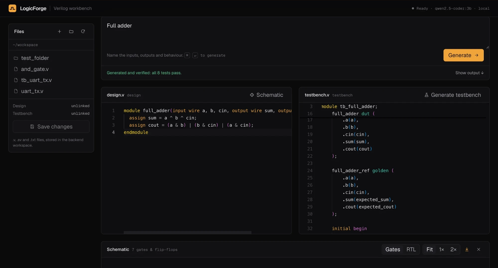
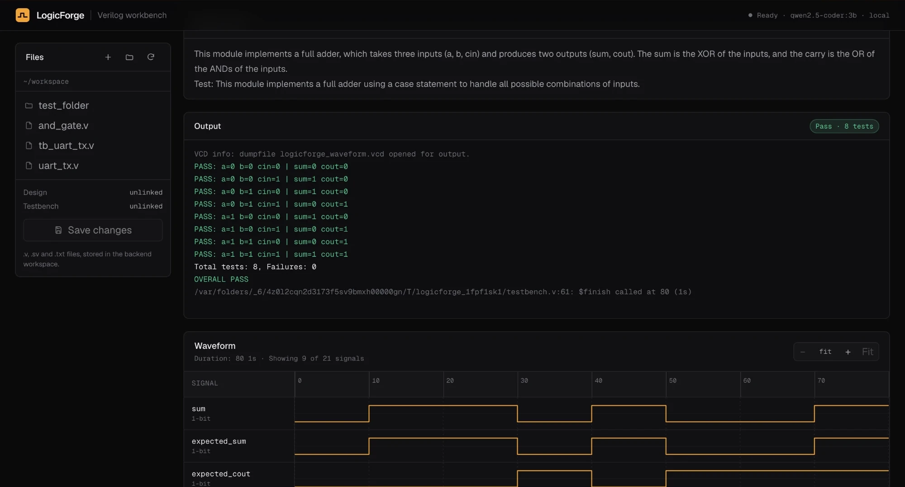
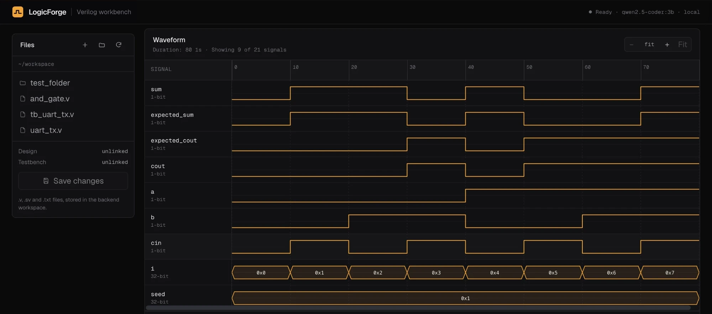
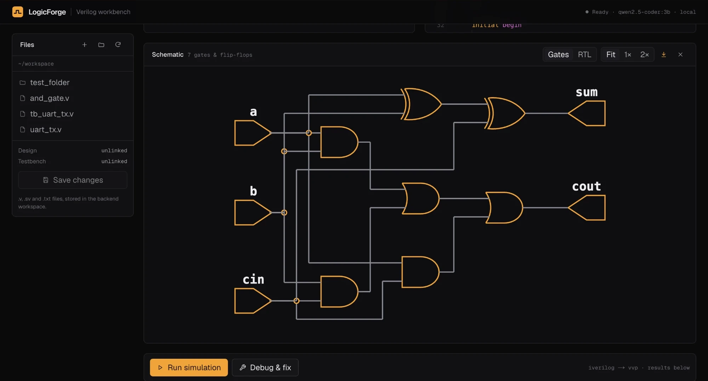
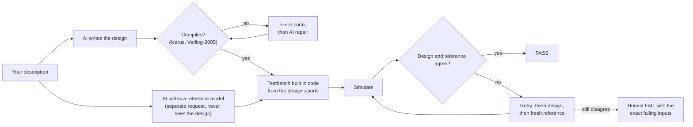

<div align="center">

# LogicForge AI

**Describe a digital circuit in plain English. Get Verilog that is compiled, simulated and verified, with a waveform and a schematic.**

[](https://logic-forge-ai.vercel.app)


</div>

> **Live demo:** [logic-forge-ai.vercel.app](https://logic-forge-ai.vercel.app). The hosted
> version is password-protected because it runs simulations and AI requests on a
> shared server; ask the author for access, or [run it locally](#run-it-locally) in a few minutes.



---

## Why LogicForge

### The problem

**AI writes Verilog that looks right but often isn't, and most people can't tell.**

Students, and increasingly engineers, ask ChatGPT, Claude or Copilot for
Verilog. The code compiles and looks plausible, but it is often wrong: wrong
bit widths, `reg`/`wire` mistakes, logic that fails for some inputs. Worse,
when the same AI also writes the testbench, the testbench tends to share the
design's mistakes and still print "PASS".

A beginner has no way to notice: writing a proper self-checking testbench is
exactly the skill they don't have yet, and installing and running a simulator
is a hurdle of its own.

### What LogicForge solves

1. **"Is this code actually correct?"** The testbench structure is generated
   by code, not by the AI, so it cannot be wrong. The design is checked
   against an **independently written** reference model, and PASS is only
   reported when tests really ran and really passed. Every failure shows the
   exact inputs, the expected values and the actual values.
2. **Testbench drudgery.** Exhaustive input testing, clocks, resets and
   comparisons are generated automatically, also for designs you wrote yourself.
3. **The setup barrier.** Simulator, waveform viewer and schematic run in the
   browser, with nothing to install.

**In one sentence:** LogicForge solves *"I can't trust AI-generated Verilog
and I can't verify it myself"* for the circuits students and learners
actually work with. As more hardware code is written with AI, the bottleneck
moves from *writing* code to *trusting* it, and that is the part this project
addresses.

### Who it's for

- **Students learning digital design.** See the code, a test that really
  checks it, the waveform, and the hardware it becomes, for every circuit.
- **Anyone checking their own small designs.** Paste a module, click
  **Generate testbench**, and get exhaustive tests with an honest verdict.
- **Teachers and TAs** who want verified examples of standard circuits.

It is not a replacement for professional EDA tools (Vivado, Quartus,
Questa, formal verification) used on large production designs.

## What it does

Type *"full adder"* and press **Generate**. LogicForge:

1. **Writes the Verilog design** with an AI model and compiles it with Icarus Verilog.
2. **Builds a self-checking testbench** for it: every input combination, or
   random vectors for wide inputs, plus clock and reset for sequential circuits.
3. **Simulates the two against each other** and reports a real
   **PASS / FAIL** for every test case, never a guess.
4. **Shows the waveform** of every signal and **draws the circuit** as a
   gate-level or RTL schematic.

You can also open or paste your own Verilog and use the simulator, the
waveform viewer, the schematic and **Debug & fix** without any AI at all.

| Simulation results | Waveform |
|---|---|
|  |  |

**Gate-level schematic**, drawn automatically from the design with Yosys:



## Features

- **Natural language → verified Verilog**: design, testbench and verdict in one click.
- **Honest verification**: the testbench compares the design with an
  independently written reference model, so a PASS means two separate
  implementations agree. A testbench that runs no tests or prints no summary
  is never reported as a pass.
- **Automatic repair**: common mistakes (`assign` to a `reg`, width
  mismatches, a missing clock or `endmodule`, …) are fixed in code; whatever
  is left goes back to the AI with the exact compiler error and line.
- **Debug & fix**: finds the root cause of a failing simulation and proposes
  a corrected design or testbench, and never pastes prose into your editors.
- **Waveform viewer**: fits the whole run to the panel, zooms to 64×, buses in hex.
- **Schematics**: gate view (AND/OR/XOR/MUX gates and flip-flops) or RTL view
  (adders, comparators, muxes, registers), with SVG download.
- **Workspace**: a file explorer for `.v` / `.sv` / `.txt` files and Monaco editors.
- **Bring your own AI**: local Ollama, free cloud tiers (Groq, Gemini,
  OpenRouter), Claude, or AI switched off.

## How verification works



The testbench structure (declarations, stimulus, clock/reset, comparisons,
summary) is generated by code, not by the AI, so it is correct by
construction. The AI only writes the two things that need understanding: the
design and an independent reference model of it.

## Tech stack

| Layer | Technology |
|---|---|
| Frontend | Next.js 16, React 19, Tailwind CSS 4, Monaco Editor, Geist fonts |
| Backend | Python, FastAPI |
| Simulation | Icarus Verilog (`iverilog`, `vvp`) |
| Schematics | Yosys synthesis + netlistsvg |
| AI | Ollama, Groq / Gemini / OpenRouter (OpenAI-compatible), Anthropic Claude |
| Hosting | Vercel (frontend), Render with Docker (backend) |
| Tests | pytest: 146 tests, about 4 seconds |

## Run it locally

**Requirements:** Python 3.10+, Node.js 20.12+, and on macOS:

```bash
brew install icarus-verilog yosys
```

For local AI (optional), install [Ollama](https://ollama.com) and pull a model:

```bash
ollama pull qwen2.5-coder:3b
```

**Backend** (http://localhost:8000):

```bash
cd backend
pip install -r requirements.txt
npm install
uvicorn main:app --reload
```

**Frontend** (http://localhost:3000), in a second terminal:

```bash
cd frontend
npm install
npm run dev
```

Open http://localhost:3000 and click one of the example prompts.

## Choosing the AI model

Copy `backend/.env.example` to `backend/.env`, set `LOGICFORGE_AI_PROVIDER`,
and restart the backend. The active model is shown in the app's top-right corner.

| Provider | Setting | Cost | Notes |
|---|---|---|---|
| Ollama | `ollama` (default) | Free, offline | Quality depends on the local model you pull |
| Groq | `groq` + `LOGICFORGE_AI_API_KEY` | Free tier | Large open models, very fast |
| Google Gemini | `gemini` + `LOGICFORGE_AI_API_KEY` | Free tier | |
| OpenRouter | `openrouter` + `LOGICFORGE_AI_API_KEY` | Free `:free` models | |
| Claude | `anthropic` + `ANTHROPIC_API_KEY` | Paid | Best for FSMs, ALUs and protocols |
| Off | `none` | Free | Simulation, waveforms and schematics still work |

A cloud provider without a key switches AI off automatically instead of failing.

## Deployment

The live demo runs the frontend on **Vercel** and the backend on **Render**
(Docker, since it needs Icarus Verilog and Yosys), entirely on free plans.
The deployed backend adds a shared access password, per-visitor rate limits
and resource limits on every simulation. Step-by-step guide: **[DEPLOY.md](DEPLOY.md)**.

## Tests

```bash
cd backend
pip install -r requirements-dev.txt
python3 -m pytest
```

146 tests run in about 4 seconds without calling any AI model (a scripted
stub stands in for it). They cover simulation and verdicts, the testbench
builders, the automatic code fixes, the generation pipeline, Debug & fix,
the free AI providers and AI-off mode, the HTTP API, security (password,
rate limits, CORS) and schematics. Tests that need Icarus Verilog or Yosys
are skipped when those tools are not installed.

## Project structure

```
backend/
  main.py                  FastAPI app, CORS, security middleware
  config.py                settings (AI provider, password, rate limits)
  api/                     routes and security (password, rate limiting)
  ai/prompts.py            prompts for design, reference model and repair
  services/
    generation_pipeline.py design → testbench → verify → retry
    testbench_builder.py   port parsing and testbench generation
    simulation_service.py  Icarus compile / simulate, verdicts, sandboxing
    schematic_service.py   Yosys + netlistsvg schematics
    ai_service.py          AI providers, automatic fixes, Debug & fix
  tests/                   pytest suite and Verilog fixtures
  Dockerfile               backend image for Render or any Docker host
frontend/
  pages/index.tsx          the workbench UI
  utils/api.ts             API client (backend URL, access password)
docs/screenshots/          images used in this README
render.yaml                Render blueprint
DEPLOY.md                  deployment guide
```

## Limitations

- **Generation quality depends on the model.** Small local models handle
  gates, adders, multiplexers, counters and flip-flops well; complex designs
  (FSMs, UARTs, ALUs) need a larger model such as a free Groq model or Claude.
  For those, LogicForge *detects* that a design is wrong, but a small model
  may not be able to produce a correct one: detecting a problem is not the
  same as fixing it.
- **"Verified" means "agrees with an independent reference", not formally
  proven.** If both AI-written versions misunderstand an ambiguous request
  in the same way, they can agree and still be wrong. This is rare, but
  possible.
- **Not industry-scale verification:** no timing analysis, coverage metrics,
  formal proofs or large multi-file projects.
- **Ambiguous descriptions** (e.g. which way a shift register shifts) can
  make the design and the reference disagree. Be specific about ports and behaviour.
- **Hosted demo on free plans:** the backend sleeps when idle (the first
  request takes about a minute) and files saved in the workspace are temporary.

## Security notes

- Verilog that reads or writes host files (`$fopen`, `$readmemh`,
  `$writememh`, `` `include ``, `$system`, `$dumpfile` with a path) is
  rejected before simulation.
- Every Icarus / Yosys run has CPU-time, file-size and memory limits, and the
  container runs as an unprivileged user.
- The API accepts requests only from configured frontend origins and, when
  deployed, only with the access password.
